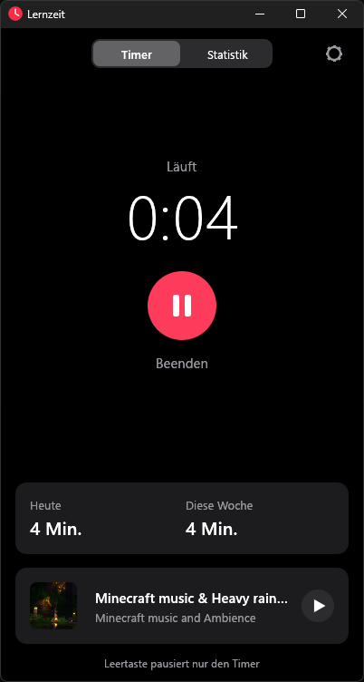

# Lernzeit

I study with Spotify playing and used the focus sessions in the Windows Clock app to time it. Two things bothered me. The Clock app shows little more than today's total, so I never knew how much I studied this week. And when I paused the music for a break, I often forgot to pause the clock, so the time was wrong.

Lernzeit is a study timer that follows Spotify. Pause the music and the timer pauses at the same second. Play it again and the timer goes on. It keeps every session and shows how much you studied per day, week, month and year, at what time of day, and which songs, artists and podcasts you listened to while studying.

  
  

The app is in German.

## Install

Windows 10 or 11 (64-bit). Download `Lernzeit-Setup-0.1.2.exe` from the [latest release](https://github.com/Nikityyy/lernzeit/releases/latest) and open it. It installs for your Windows account, adds Lernzeit to the Start menu, and offers a desktop shortcut. It needs no admin password or internet connection.

To update, quit Lernzeit from its tray menu and run the newer installer. Your history stays in `%APPDATA%\Lernzeit`. Uninstalling removes the app and shortcuts but keeps that history.

The installer is not code-signed yet, so Windows may show an unknown-publisher or SmartScreen warning. The release includes a SHA-256 checksum. `Lernzeit.exe` is also available if you prefer to run it without installing.

To build it yourself, install [Rust](https://rustup.rs) with the Windows MSVC build tools and run `cargo build --release --locked`. To build the installer, also install [Inno Setup 6.7.4](https://jrsoftware.org/inno-setup/downloads) and run `powershell -File .\build-installer.ps1`.

## Use

Press the red button or the space bar to start a session. Lernzeit never starts one on its own; music alone does not count as study time.

- **Spotify pauses**: the timer pauses at the moment the music stopped.
- **Spotify plays again**: the timer goes on, but only if Spotify paused it. A timer you paused yourself stays paused.
- **Space bar**: in Settings you choose what it pauses: the timer and the music, only the timer (the music keeps playing), or only the music.
- **Closing the window** keeps Lernzeit in the tray. Quit it from the tray menu.

A study day ends at 4:00 in the morning, so a session past midnight counts for the day you started it. Spotify Free ads are not counted as music.

On first launch, Lernzeit takes over every focus session (Fokussitzung) recorded in the Windows Clock app, so the time you already tracked is not lost. Close the Clock app first: while it is open, Windows locks its data, and Lernzeit tries again on the next launch.

## How it works

Lernzeit reads Spotify through Windows' media controls, the same ones behind the media keys and the volume flyout. It needs no Spotify account or login, and it works with the Spotify desktop app only.

Sessions and listening go into two JSON Lines files, one line per stretch. A running session is saved every 30 seconds, so a crash or shutdown loses at most that much.

## License

MIT
